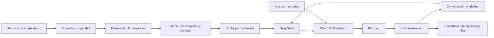

# Diseño y referencias

## Objetivo

Un propietario que edita podcasts con avatares, cámara, audio separado y B-roll, desde Windows o un servidor. El briefing se define conversando con un agente económico; Gemini analiza contenido audiovisual; un motor determinista ejecuta los cortes; el usuario previsualiza y decide cuándo exportar. Idiomas del material y subtítulos elegibles: español, inglés y francés.

## Decisiones

- Python/FastAPI, interfaz sin compilación ni CDN y FFmpeg: instalación razonable en Windows y Linux, sin GPU obligatoria y sin depender de un framework de vídeo en JavaScript.
- Los medios se copian a un directorio con IDs aleatorios; los nombres del usuario no se ejecutan ni se usan como rutas. Se inspeccionan con ffprobe. No se aceptan rutas locales arbitrarias desde la API.
- El plan es una lista de cortes secuenciales. Cada corte señala un archivo visual y su intervalo; opcionalmente señala un audio y otro inicio. Un archivo de solo audio genera un fondo oscuro. No hay sincronización automática ni mezcla de varias voces simultáneas. Sí hay una banda sonora independiente con mezcla y compresión sidechain.
- Clips definidos sobre la línea de salida. Al recortarlos se recalculan el inicio visual, el inicio del audio separado y los tiempos de subtítulos para evitar desfases al cruzar cortes.
- La validación comprueba identificadores, números finitos, intervalos, duraciones y existencia de audio. Ningún modelo genera comandos de shell. FFmpeg usa argumentos separados y `shell=False`.
- El agente recibe transcripciones como datos y devuelve JSON validado. Los resultados de modelos nunca se ejecutan como código. El proyecto usa una revisión para detectar escrituras concurrentes; una propuesta que llega tras guardar otra versión se rechaza.
- Un solo worker de aplicación y una cola de un hilo de trabajo limitan presión de CPU y carreras entre renders. Los trabajos y archivos sobreviven al reinicio, pero no se reanudan automáticamente los procesos interrumpidos.
- Los renders usan instantáneas del plan para que un cambio posterior no altere un trabajo en curso. La interfaz identifica entregas de revisiones anteriores.
- La mejora de voz se aplica al diálogo concatenado antes de la mezcla. RNNoise mediante `arnndn` hace reducción neuronal de ruido; la opción clásica usa `afftdn`. Ambas añaden filtro de graves, presencia y compresión suave. Un modelo pequeño BSD va incluido y no requiere descargas ni claves.
- Audio del diálogo normalizado con `loudnorm`, música con volumen absoluto y sidechain opcional, fundidos y limitador final. La canción se decodifica a PCM antes de repetir para evitar deriva por padding MP3. El offset de clips es inicio musical + inicio del clip sobre el episodio.
- Beats: envolvente de energía de graves, cambios positivos, umbral local y separación mínima; caché por SHA-256 y versión. BPM es una estimación de intervalos, no un análisis semántico de compases. La duración decodificada guía la repetición. El snap mueve límites de cortes existentes, conserva entradas y duración total, comprueba capacidad de imagen/audio y deja un plan anterior para deshacer.
- La precisión temporal está limitada por fotogramas (25 fps), códec y análisis de frase.
- Subtítulos en idioma original desde análisis de la pista de audio efectiva. Traducciones de texto por DeepSeek en lotes, conservando tiempos. No es doblaje. Se incrustan en el vídeo y se ofrece SRT.
- La caché evita repetir análisis/translaciones sin cambios. No constituye un presupuesto económico: no hay contador de gasto. El operador debe configurar cuotas en los proveedores.
- Token compartido opcional para localhost y requerido para acceso remoto, cookie HttpOnly, comprobación de origen en escrituras y medios protegidos por la misma autenticación. HTTPS y proxy corresponden al despliegue.

## Repositorios públicos consultados

Consulta inicial: 8 de noviembre de 2026. Se leyeron sus README públicos. No se ha copiado código ni integrado un fork; por eso no se trasladan dependencias pesadas ni se afirma equivalencia de funcionalidades.

| Referencia | Idea útil | Decisión para Agntia |
| --- | --- | --- |
| [WyattBlue/auto-editor](https://github.com/WyattBlue/auto-editor) | Primera pasada con cortes de audio, márgenes y exportación | Conservar plan de edición explícito. La eliminación automática de silencios con márgenes queda como ampliación; cortar silencio sin revisar puede romper pausas expresivas. |
| [m-bain/whisperX](https://github.com/m-bain/whisperX) | Tiempos por palabra, alineación y diarización; modelos por idioma | Buena futura alternativa local para español/inglés/francés. No se instala en el MVP para evitar pesos, GPU y pasos extra de diarización. Gemini aporta tiempos de frase aproximados. |
| [modelscope/FunClip](https://github.com/modelscope/FunClip) | Selección de fragmentos por transcripción y propuestas de LLM | Adoptar el flujo transcripción → propuesta → revisión, con DeepSeek configurable y una capa propia para pistas separadas/B-roll. |

Antes de incorporar código, modelos o binarios de cualquiera de ellos, revisar sus licencias de la versión concreta y las de sus dependencias. Aquí son referencias conceptuales; MIT solo licencia el código original de este proyecto.

## Próximas ampliaciones posibles

Sincronización automática por forma de onda; mezcla de varias voces; alineación local con WhisperX; cortes de silencio con márgenes; encuadres que sigan al hablante; importación/exportación OpenTimelineIO; subidas reanudables; almacenamiento S3 y autenticación por usuario. No forman parte de la versión actual.
